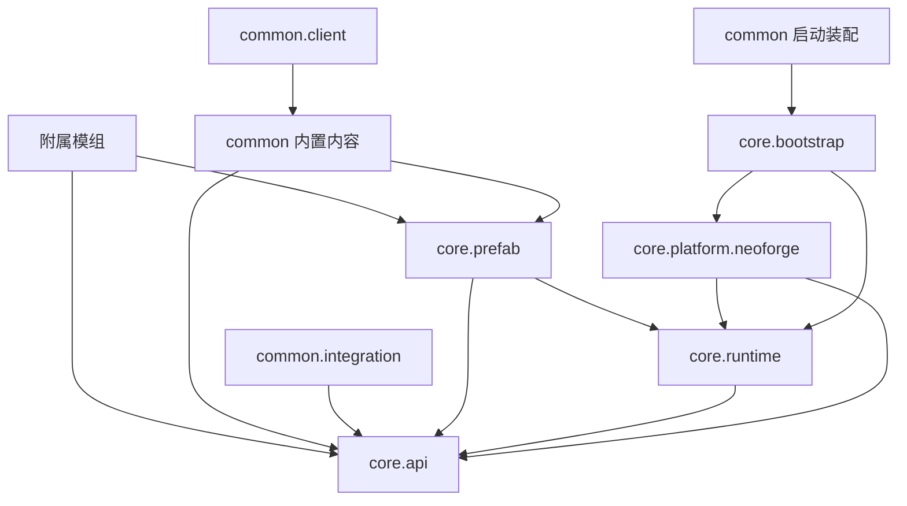

# Singularity Iteration：core / common 重构方案

状态：架构拆分、全量迁包、独立 core 开发包与公开入口收尾已落地；自动化检查已通过，完整实机验收仍待逐项记录。更新：2026-09-29，模组版本 `0.1.7.14`，公开 API 兼容版本 `1.0`。实际范围与验证结果见 [实施记录](core_common_refactor_progress.md)，附属用法见 [开发指南](core_addon_guide.md)。

本方案以制定时的工作区文件为基准，包含尚未提交、尚未跟踪的 Java 实现；不是以 Git HEAD 或已有旧文档为基准。参考对象为本地 `source/IC2Code 1.12.2/ic2`。下文保留迁移前的分析及阶段验收要求；实施状态以实施记录为准。

2026-09-29 收尾：附属电网通知/诊断与多方块控制器注册改走公共服务；历史存储和缓冲区入口保留签名并标记内部兼容用途；新增编译后依赖与公开/受保护签名检查及反例测试。内置配方类型绑定、UU 数据目录留在 common 符合内容分层要求。进一步细化大型机器组件属于后续维护，不再列为整体迁包的阻塞项。当前发布形态不要求独立 core 前置模组；客户端、旧存档与可选集成仍按第 12 节验收。

## 1. 建议采用的总体结构

按需求将根包改为 `com.miophas.singularity_iteration`，下面设置 `core` 与 `common`：

- **core：可供主模组和附属共同依赖的开发框架。** 包含公开接口、数据模型、扩展注册入口、通用方块实体与物品基类、机器组件、能量与处理引擎、必要的 NeoForge 适配。
- **common：使用 core 实现的主模组内容。** 包含具体方块、物品、机器参数、配方类别、世界生成、注册、第三方集成，以及 `common.client` 中的客户端实现。

这里的 `common` 表示主模组实现层，因此可以按需求容纳 `client` 子包；其中服务端可加载代码仍不得直接依赖客户端类。

**core 不只是接口集合，也必须包含可复用的基础实现。** 否则附属创建机器时仍要继承 `common` 中的类，重构目标就没有完成。

同时，不能把当前 `api`、`energy`、`Blocks/entity` 的文件直接整包移动：其中既有通用机制，也有内置内容、具体机器特判和第三方集成，必须先拆开依赖。

本轮默认发布形态：**一个完整游戏模组 JAR，加一个供附属编译使用的 core 开发依赖。** Java 分层和编译边界先独立，不立即要求玩家额外安装一个独立 core 模组。独立运行的 core 前置模组作为后续可选发布形态，见第 10 节。

## 2. 当前实现的检查结果

### 2.1 范围和规模

扫描 `src/main/java/com/singularity_iteration/mio_icif` 下的 `.java` 文件共 **1,453 个**，包括 `package-info.java`，不包括 `.bak` 文件。其中：

| 现有目录 | Java 文件数 | 主要处理方向 |
| --- | ---: | --- |
| `api` | 201 | 拆为公开契约、通用实现、内置内容服务 |
| `energy` | 102 | 抽取存储、结算、网络、热能、动能；移出内置参数与第三方适配 |
| `Blocks` | 376 | 通用骨架进入 core，具体方块和实体进入 common |
| `Items` | 156 | 通用电力物品、升级计算、通用数据抽取到 core |
| `Menu` / `Screen` / `Render` / `client` | 109 / 106 / 11 / 14 | 菜单公共机制与客户端显示分开 |
| `recipe` / `processing` / `uu` | 116 / 35 / 11 | 配方与处理机制和内置配方目录分开 |
| `integration` | 77 | 留在 common，按服务端与客户端集成划分 |
| `reactor` / `multiblock` / `crop` | 11 / 8 / 37 | 通用计算及扩展契约抽取到 core；内置结构与品种留在 common |

检查方式：全目录与依赖引用扫描，重点阅读 API 入口、能量基类、存储、网络入口、独立能量引擎、机器构建器、能力注册、启动入口，以及 IC2 对应实现。此处是架构评估，不代表所有具体机器已经完成逐方法行为审计。

构建基线来自当前文件：Minecraft `1.21.1`、NeoForge `21.1.218`、Java `21`、ModDevGradle `2.0.141`；目前为单 Gradle 工程，主要代码位于 `sourceSets.main`。

### 2.2 必须先拆开的实际依赖

| 位置 | 当前事实 | 对重构的影响 |
| --- | --- | --- |
| `Blocks/entity/mio_icif_Energy_Block.java` | 594 行；同时处理存储、网络生命周期、EU/FE 端口、NBT、升级、扳手、菜单；端口判断引用生产机器、储能箱、线缆、模板存储机 | 必须拆为能量宿主契约、组件和组合式基类，消除具体机器特判 |
| `energy/CustomEUEnergyStorage.java` | 522 行；存储还处理世界上下文、所有权、网络账本、过载，并检查 `mio_icif_Energy_Block` | 拆开数值存储、宿主有效性、网络访问、过载处理；不能留下 core → common |
| `energy/IndependentSiEnergy.java` | 1,869 行；包含服务器实例管理、网络计算和大量内置设备参数；`controls()` 有 `mio_icif` 命名空间判断 | 引擎和内置设备描述分离；为附属提供显式接入，不靠修改核心白名单 |
| `energy/grid/EnergyNetGlobal.java`、`GridEventHandler.java` | 现有入口已经转发到 `IndependentSiEnergy`，不是另一套独立活动电网 | 重构保持唯一运行引擎，不额外恢复一套旧电网 |
| `api/internal/energy/GenericEnergyBlockEntity.java` 等 | 所谓通用 API 实体直接继承 `Blocks/entity` 中的基类 | 基类本身必须下沉到 core；不能只移动 API 外壳 |
| `api/MioIcifAPIHolder.java` | API Holder 内部直接创建多种 `*Impl`，包含通用服务与内容相关服务 | 改为接口入口和显式服务装配；common 提供内容服务实现 |
| `api/machine/builder/MachineBuilderAPIImpl.java` | 1,901 行；定义、回调表、多个构建器实现集中在一起；`registerMachine()` 记录定义，实际类型需预先提供 | 拆分定义构建和实际 NeoForge 注册，避免把定义登记误当成 Block/BE 注册 |
| `Blocks/entity/mio_icif_producer.java` | 1,436 行；包含槽位、升级、生产、流体、音效，并特判装罐机 | 通用处理框架下沉，特殊槽位/流体路由和音效由 common 注入 |
| `Blocks/entity/mio_icif_standard_producer.java` | 已有离散处理时序、每 tick 扣费、多操作和进度恢复逻辑 | 保留并抽取为标准处理机制，不能与旧 producer 行为直接混并 |
| `Blocks/entity/mio_icif_Energy_Generator.java` | 847 行；直接依赖 MI/GT 集成 | 第三方输出桥移到 common，通过 core 扩展契约接入 |
| `api/item/AbstractBattery.java`、`api/capability/BatteryBridge.java` | 分别依赖 Curios 适配、`Items.Normal` 下的电池数据组件 | 通用电池框架下沉；装备查找通过扩展点接入；通用数据组件抽取 |
| `Blocks/mio_icif_capacities.java` | 大量具体实体能力注册，与能力本身的定义混在同一使用链上 | 能力定义/辅助注册进入 core；内置实体的注册清单进入 common |
| `api/recipe/RecipeFactoryBridge.java`、`RecipeTypeBridge.java` | 引用具体配方类与注册表 | 通用配方工厂与内置类型目录分离 |
| `multiblock/mio_icif_multiblock_manager.java` | 通用管理逻辑中引用具体反应堆、GESU、大型制造机 | 管理器接受结构描述/验证器，内置结构注册留在 common |

还需要处理两类隐蔽依赖：

1. `Singularity_Iteration` 直接调用屏幕注册入口；物品包中的 `BatteryEnergyProperty`、`DynamicCellColorProvider` 等导入客户端类。迁包时必须一起审计加载链，不能只移动现有 `client` 目录。
2. 目前模板声明 `mio_icif` 与 `scex_energy_platform` 两个 mod ID，存在两份 mixin 配置。后者当前有一个空 `@Mod` 入口。它们属于启动/发布兼容事项，不能在改根包时顺手删掉。

## 3. 从 IC2 1.12.2 借鉴什么

本地参考目录中的 IC2 主要使用 `ic2.api` 与 `ic2.core`，**并不是本方案的 core/common 命名划分**。本方案借鉴职责组织，按当前项目和 NeoForge 环境重新划界。

| 本地 IC2 实现 | 观察到的组织方式 | 本项目的应用方式 |
| --- | --- | --- |
| `ic2/api/energy/IEnergyNet.java`、`EnergyNet.java` | 对外通过接口及服务入口访问网络 | core 公开网络查询与接入契约，隐藏拓扑、路径、结算内部类型 |
| `ic2/api/energy/tile/*` | Source、Sink、Conductor 等角色独立 | 分开输入、输出、导体、储能角色，避免所有机器默认承担所有角色 |
| `ic2/api/energy/prefab/BasicEnergyTile.java`、`BasicSink.java` | 附属可以组合能量对象，转发生命周期、保存和读取 | 提供可组合的 `EnergyComponent`，允许附属保留自己的 BE 继承体系 |
| `ic2/core/block/comp/Energy.java` | 主模组机器也复用能量组件 | common 的内置机器与附属使用同一套 core 机制 |
| `TileEntityElectricMachine.java` | 组合能量组件与放电槽 | core 提供电力机器基类和独立的槽位、充放电组件 |
| `TileEntityStandardMachine.java` | 标准加工周期、升级、配方输入输出集中复用 | core 提供标准加工控制器和可继承骨架 |
| `TileEntityBaseGenerator.java` | 发电机骨架组合能源与充电槽 | core 提供发电过程接口和通用骨架，燃料类别与产能参数由内容提供 |
| `ic2/api/item/ElectricItem.java` | 电力物品通过管理服务工作，可接入后备实现 | 保留统一电池转移与适配入口，扩展处理外部电力物品 |
| `ic2/api/recipe/Recipes.java` | 配方类别通过管理接口暴露 | 提供公开配方类型描述和注册服务；内置类别绑定留在 common |

不直接照搬 IC2 中与旧版 TileEntity、NBT、GUI、Forge 生命周期绑定的代码；也不因 IC2 用某种数值表示，就替换当前实现已经具有的精确结算方式。

## 4. 包结构与依赖规则

### 4.1 目标目录

```text
src/main/java/com/miophas/singularity_iteration/
├── core/
│   ├── api/                     # 稳定公开契约、值对象、事件、能力入口
│   │   ├── energy/              # EU、网络角色、能量访问
│   │   ├── heat/                # HU 契约
│   │   ├── kinetic/             # KU 契约
│   │   ├── machine/             # 机器信息、配置、定义与构建器契约
│   │   ├── item/                # 电池、电动工具、护甲、转子等契约
│   │   ├── inventory/
│   │   ├── fluid/
│   │   ├── recipe/
│   │   ├── upgrade/
│   │   ├── reactor/
│   │   ├── crop/
│   │   ├── multiblock/
│   │   ├── network/
│   │   ├── capability/
│   │   ├── content/             # 主模组内容查询接口；实现不在这里
│   │   └── event/
│   ├── prefab/                  # 对附属承诺兼容的可复用实现
│   │   ├── block/
│   │   ├── blockentity/
│   │   ├── component/
│   │   ├── item/
│   │   ├── inventory/
│   │   ├── menu/                # 不含 Screen、渲染和 Minecraft 客户端类
│   │   └── recipe/
│   ├── runtime/                 # 内部实现，不作为附属直接调用入口
│   │   ├── energy/              # 存储、账本、拓扑、传输调度
│   │   ├── machine/
│   │   ├── processing/
│   │   ├── item/
│   │   ├── recipe/
│   │   ├── upgrade/
│   │   ├── reactor/
│   │   ├── crop/
│   │   ├── multiblock/
│   │   └── uu/
│   ├── platform/neoforge/       # 世界生命周期、事件、能力辅助、通用网络同步
│   └── bootstrap/               # 核心初始化与服务装配入口
└── common/
    ├── SingularityIteration.java
    ├── bootstrap/
    ├── registry/                # 内置方块、物品、BE、菜单、能力等注册
    ├── block/
    ├── blockentity/
    ├── item/
    ├── menu/
    ├── recipe/
    ├── energy/                  # 内置设备描述、参数、特殊行为策略
    ├── machine/
    ├── crop/
    ├── reactor/
    ├── multiblock/
    ├── uu/
    ├── network/
    ├── world/
    ├── entity/
    ├── effect/
    ├── config/
    ├── service/                 # core 内容查询接口的主模组实现
    ├── integration/             # MI、GT、AE2、Mekanism、Curios 等
    ├── mixin/                   # 与具体内容绑定的注入
    └── client/
        ├── screen/
        ├── render/
        ├── model/
        ├── input/
        ├── tooltip/
        └── integration/         # JEI、EMI、REI 等客户端实现
```

这是职责目录，实施时按实际需要建立，避免先制造没有用途的空包。包名统一小写，新建公共类使用正常 PascalCase，不继续扩散 `mio_icif_*` 类名。

### 4.2 允许的依赖



约束：

1. `core` 的任何类、签名、注解、反射字符串和资源配置都不依赖 `common`。
2. `core.api` 不引用 `core.runtime`、`core.prefab` 的具体实现类型。公开入口的默认服务通过装配绑定，不在接口 Holder 中创建 common 实现。
3. 附属使用 `core.api`、`core.prefab` 及明确文档化的注册辅助入口；`runtime` 的 public 仅用于框架内部，不构成兼容承诺。
4. `core` 可以依赖 Minecraft/NeoForge；它不是跨加载器、纯 Java 的完整框架。纯算法子包尽量保持无游戏依赖。
5. `core` 不依赖 MI、GT、Curios、AE2、JEI 等可选模组。扩展接口由 core 声明，适配对象由 common 注入。
6. 非客户端代码不得引用 `common.client` 的实现类。客户端入口独立注册，服务端启动不加载 Screen、渲染器和物品模型属性类。
7. 内置注册表只在 common；通用电池等核心组件确实需要的 DataComponent 注册可由 core 定义、启动时装配，并保留原 ID。

## 5. 能量基类与运行引擎的拆分

### 5.1 `mio_icif_Energy_Block` 的目标形态

建议将其重构为 `core.prefab.blockentity.AbstractEnergyBlockEntity`，通过组件组合实现主要职责。以下名称均为拟定名称。

| 现有职责 | 目标类型/位置 | 说明 |
| --- | --- | --- |
| 机器拥有的能量、容量、内部消耗与生成 | `EnergyComponent` + runtime 存储实现 | 同一设备只有一个真实能量余额 |
| 有效宿主、坐标、服务端线程、区块存活判断 | `EnergyHost` 契约及平台适配 | 替代对某个具体 BE 类的所有权检查 |
| 输入/输出面与设备角色 | `EnergyPortPolicy`、`EnergyNodeDescriptor` | 避免用 `instanceof 储能箱/生产机器/线缆` 决定通用行为 |
| EU/FE 端口与单 tick 配额 | runtime 端口适配、统一账本 | 端口共享结算状态，不能各自再持有能量副本 |
| 加载、移除、区块卸载与重新加载 | `EnergyNetworkService` + 生命周期适配 | 幂等注册、及时撤销，不能重复参加结算 |
| NBT 保存、读取和同步 | 组件序列化及基础同步代码 | 第一阶段沿用现有字段与格式 |
| 过压与爆炸 | `OverloadPolicy` | 通用机制位于 core，设备特殊规则由 common 提供 |
| 升级、扳手、菜单 | 独立接口/组件和更上层机器骨架 | 能量实体不必天然拥有升级槽或 GUI |

公开能力应该返回接口；`CustomEUEnergyStorage`、`NetworkCell`、账本等可变内部对象不再从新 API 暴露。内部消费与对外提取的语义分开，避免附属通过外部能力绕过方向、预算和网络控制。

提供两种正式接入方式：

- **继承方式：** 附属继承 `AbstractEnergyBlockEntity`、`AbstractProcessingMachineBlockEntity` 等，填写配置与行为钩子。
- **组合方式：** 附属保留自己的 `BlockEntity` 父类，持有 `EnergyComponent`，转发生命周期与序列化，并注册端口提供者。

组合方式是必要目标，不能强迫所有附属继承唯一的大型机器父类。

### 5.2 对当前能量实现的迁移表

| 当前实现 | 目标 |
| --- | --- |
| `energy/EnergyUnit/IEUEnergyStorage`、`ILongEnergyStorage`、`api/energy/IEnergyStorageAccess` | 整理为 `core.api.energy` 的公开契约；旧接口通过适配过渡，避免继续新增互相重叠的存储接口 |
| `ICableTier`、`CableTier`、`CableTierHolder` | 等级契约/标准等级描述进入 core；材质、纹理、具体电缆内容参数留在 common；兼容现有等级编号 |
| `energy/grid/IEnergy*`、`ILocatableTile`、`NodeStats` | 角色和不可变查询结果进入 `core.api.energy`；查询结果不再泄露内部 grid 包 |
| `CustomEUEnergyStorage`、`CustomEnergyStorage` | 存储默认实现进入 runtime；公开创建与组合入口放在 prefab/API |
| `energyfix/EnergyAmount`、`NetworkCell`、`*Ledger`、`*Distributor`、`ConductorGraph`、`ConductorRegistry` 等 | 进入 `core.runtime.energy` 下的数值、结算、拓扑子包；保留现有算法和精度 |
| `IndependentSiEnergy` | 拆为核心网络服务、世界运行状态、设备接入解析；内置参数表移至 `common.energy` |
| `EnergyNetGlobal`、`GridEventHandler` | 迁为服务门面和 NeoForge 生命周期连接；继续使用同一个活动引擎 |
| `energyfix/minecraft/PlatformTopology`、`ContactOrder` 等 | 平台相关机制进入 `core.platform.neoforge.energy`，纯排序/图逻辑进入 runtime |
| `IndependentTransformerBlockEntity`、`IndependentSpecialCableBlockEntity` | 通用行为抽取到 core；内置实体工厂及按方块 ID 选择的部分留在 common |
| `energyfix/minecraft/integration/*Factory`、设备类型替换 mixin | 先归 common 集成层；减少对默认工厂的特殊替换后再评估是否保留 |
| `EUApi`、`HUCapabilities`、`KUCapabilities`、公开能力常量 | 进入 `core.api.capability`；提供者注册辅助进入平台层 |
| `heat/*`、`kinetic/*` | 契约进入 api，存储/传输进入 runtime，可组合组件与实体基类进入 prefab |
| `FeLedger`、`InternalPaymentLedger`、`BatteryTransfer`、`BatteryFeCapability` | 通用结算机制进入 core，不创建独立余额 |
| `FeMachineBridge`、`MachineItemDischarging`、`StorageItemCharging`、`ContainerToTank` | 去掉具体机器引用，依赖宿主、库存、端口契约后进入 core |
| `ToolEnergy`、`EnergyPackCharging`、`SolarItemCharging`、`SolarHelmetCharging` | 通用能源操作进入 core；装备查找与内置参数通过接口提供 |
| `StoredFuelGeneration`、`FluidFuelGeneration`、`WorldFuelCollection` | 通用燃料转移/记账进入 core；燃料选择、世界对象筛选与产能配置留在 common |
| `ThermalOutput`、`KineticOutput`、`OwnedHeatExchange`、`ElectricMotorKinetics` | 通用转移/转换契约与控制器进入 core；具体电动机状态、属性绑定留在 common |
| `OwnedChunkTickets` | 通用区块票据服务可抽取到平台层；具体区块加载机控制留在 common |
| `MekanismStrictEnergyBridge`、`FECompatTile` 中的 MI/AE2 专属逻辑 | 移入 common 集成；通用 FE 适配保留在 core |
| `SolarGeneratorProfile` 中的内置 ID/参数 | 移入 `common.energy`；日照与发电量计算模型保留在 core |

现有两个 `IEnergyConductor`（`api/energy/tile` 与 `energy/grid`）等近似协议需制作方法语义对照，确定一个新公开角色模型，保留必要的旧协议适配，不能只因同名就合并。

### 5.3 消除内置命名空间和设备类型依赖

当前 `controls()` 的命名空间判断说明：附属即使继承了现有通用实体，也不等于自动获得与内置机器完全相同的原生结算路径。现有显式 `registerTile()` 路径仍然存在，必须与新接入方式一起审计，不能简单宣布它无效或直接删除。

拟引入 `EnergyNodeRegistry`，以实际方块/BE 类型与公开描述注册接入行为：

- common 注册内置发电机、储能箱、导体、变压器等描述；附属通过同一入口注册自己的描述。
- 描述包含角色、端口、等级/包大小、线损、过载规则、能量宿主访问方式；不包含某个 common 实现类。
- 主动发电、按需求发电、无限能源、无线节点和多方块代理端口保留独立行为契约，不能全部套用普通储能节点。
- 对没有注册、没有宿主/端口契约的对象不自动取得其能量所有权；外部能力适配仍走明确路径。
- 描述在注册完成后冻结；世界运行状态按服务器与维度管理，服务器停止后释放，避免静态状态跨存档复用。
- 同一设备通过新旧入口出现时必须去重；兼容门面只转发到同一引擎。

### 5.4 数值和行为保持要求

第一轮结构重构不调整这些规则：

1. 当前 `EnergyAmount` 的整数部分与 52 位二进制小数表示，以及 `scex_energy_fraction` 存档数据。
2. 当前 FE 账本的 `4 FE = 1 EU` 转换、整数截断边界和共享预算。
3. `simulate` 不改变真实余额、库存、燃料或网络状态。
4. 同一台机器的 EU、FE、物品充放电和内部扣费共用受控结算边界，不因迁移生成第二份能量。
5. 卸载/移除后旧端口失效，网络遍历不强制加载邻接区块，跨维度状态隔离。
6. 保留已存在的设备特殊路径和默认独立能量模式；结构重构不同时改变产能、线损、过载阈值和转换比例。

## 6. API、通用机器与其他核心逻辑的迁移

### 6.1 当前 API 的分类规则

当前 `api` 下的内容全部纳入迁移审计，但目标位置按职责决定：

| 当前内容 | 目标职责 |
| --- | --- |
| `energy`、`machine`、`generator`、`heat`、`kinetic` 的接口、事件与只读数据 | `core.api` 对应领域；公共签名只使用契约或公共值类型 |
| `item`、`item/electric`、`armor`、`tool`、`upgrade/tile` | 电力物品、装备和升级契约进入 `core.api`；重复标记接口逐项整理 |
| `fluid`、`crop`、`reactor`、`recipe`、`network`、`util` 的通用契约 | 进入对应 `core.api` 子包，不绑定内置注册对象 |
| `AbstractBattery`、`AbstractElectricTool`、`AbstractElectricArmor` | 进入 `core.prefab.item`，移除 Curios 与具体物品目录依赖 |
| `api/internal/energy/*`、`api/internal/machine/*` | 转为正式 `core.prefab.blockentity` 扩展面；消除“internal 类却建议附属继承”的矛盾 |
| 通用 `*APIImpl`、存储适配器、构建器实现、作物注册/杂交机制 | 进入 `core.runtime`；通过接口和工厂访问 |
| `BlockAPIImpl`、`ItemAPIImpl`、`MioIcifRegistriesImpl` 的内置目录查询 | 实现进入 `common.service`；查询接口归 `core.api.content` |
| `RecipeFactoryBridge`、`RecipeTypeBridge` | 可注册的工厂/类型目录机制在 core，内置具体类型绑定在 common |
| `BatteryBridge` | 通用电池数据访问抽取到 core；移走其对 `Items.Normal` 的反向引用 |
| `NetworkHelper` | 通用同步协议在 core；具体机器按钮包、界面行为包在 common |
| `api/example/AddonExample` | 移至独立示例附属工程或测试夹具；不作为生产 API 包内容 |

不要用“所有 `*Impl` 都进 common”作为机械规则：能量存储、网络算法、通用构建器等正是 core 应该提供的依赖实现。也不要把内置物品查询服务包装成接口后，仍在 core 中写死整个主模组目录。

### 6.2 机器、库存和升级

| 当前实现 | 建议目标 |
| --- | --- |
| `mio_icif_Energy_Block` | `AbstractEnergyBlockEntity` |
| `mio_icif_producer` | `AbstractProcessingMachineBlockEntity` + 独立库存、升级、处理组件 |
| `mio_icif_standard_producer`、`StandardProcessingTiming` | `AbstractStandardMachineBlockEntity` + 标准加工时序计算 |
| `mio_icif_Energy_Generator` | `AbstractGeneratorBlockEntity` + `GenerationController` |
| `mio_icif_Energy_Container` | `AbstractEnergyStorageBlockEntity` + 输入/输出面、红石策略 |
| `mio_icif_HeatU_Block/Generator`、`mio_icif_KineticU_Block/Generator` | 对应 HU/KU 组件与实体骨架，保持各自单位和方向语义 |
| `Blocks/entity/slot/*` | 契约进入 `core.api.inventory`，通用布局和处理器进入 `core.prefab.inventory` |
| `Items/Upgrade/MachineUpgradeStats`、通用升级运算 | `core.runtime.upgrade`；公开只读属性/结果归 api |
| `IGeneratorBlockEntity` | 与公开 `IGeneratorBlock` 收敛；旧的协变返回 `CableTier` 接口作为迁移适配处理 |
| 通用 `mio_icif_entity_block` 行为 | 可复用交互/朝向/BE 工厂放在 `core.prefab.block`，清除具体菜单/内容依赖 |
| `Menu/Base/*`、通用槽位 | 只依赖机器/库存契约的部分进入 `core.prefab.menu`；具体菜单进入 `common.menu` |

EU/HU/KU 的共同发电信息可以复用，但不能继续让“累计发电量”对所有发电机都隐含为 EU。新查询契约应明确能量种类或按领域区分；旧接口保持原语义直到迁移完成。

机器构建器拆成三步：

1. **定义：** 创建不可变 `MachineDefinition`，包含参数、槽位、端口及行为工厂；此时不要求立刻取得尚未注册完成的 `BlockEntityType`。
2. **注册：** common/附属在自身模组注册流程中创建 Block、Item、BE Type、Menu Type；使用延迟句柄/工厂解决相互引用，不在静态初始化时提前 `.get()`。
3. **绑定：** 用实际类型绑定定义、能力与网络描述。辅助方法名称区分“登记定义”和“注册游戏对象”。

core 的回调参数使用 `MachineContext` 等公开上下文，避免 `Consumer<common 某个实体>`；常规逻辑仍允许通过 prefab 的受保护钩子覆写。

### 6.3 不限于 energy 的其他核心逻辑

| 当前区域 | 进入 core 的部分 | 留在 common 的部分 |
| --- | --- | --- |
| `processing` | 输入输出转移、预算、事务、扫描/复制状态、路径与处理控制器 | 具体记忆物品绑定、内置配方目录、内置机器政策 |
| `recipe/generic` 及具体配方公共代码 | 通用 RecipeInput、序列化/构建工具、处理结果模型与查找机制 | 粉碎、洗矿、装罐等内置类型注册、默认配方与展示 |
| `uu` + `processing/Uu*` | 图/求值器、报价、扫描与复制事务、缓存生命周期 | 默认价值、白名单、内置类型解析器；新旧路径确认实际调用后再归并 |
| `reactor` | `ReactorCycle`、热量、事故状态、调度等可复用模型/算法 | 燃料棒/部件目录、具体数据组件绑定、内置反应堆外壳规则 |
| `multiblock` | 结构描述、匹配接口、结果、生命周期管理与扩展注册 | GESU、流体反应堆、钻井、大型制造机的具体结构 |
| `api/internal/crop` + `crop` | 作物描述/注册、杂交、统计机制 | 小麦、咖啡、矿物作物等具体品种与掉落 |
| `flight/JetpackFlightController` | 接受装备参数的通用飞行控制 | 特定装备、Curios 查找、按键和模型 |
| `radiation/RadiationState` 及辐射工具 | 可复用状态和计算机制 | 当前效果、护甲与世界区域的内容绑定 |
| `Items/DataComponent`、`Items/Normal/mio_icif_data_components` | 核心电池、组件所必需的通用数据模型与 codec | 内置专属装备/部件数据；不把整个注册表一次搬进 core |
| `future` | 经依赖审计确认的通用调度/传输部分 | 与具体设备、物品和功能绑定的实现 |
| `util`、`utils` | 有明确通用用途且无内容引用的工具 | 标签目录、UI 常量、具体模组行为；按领域重新归位 |

## 7. 注册、初始化与客户端隔离

### 7.1 能力定义与能力提供者分开

`EUApi` / `HUCapabilities` / `KUCapabilities` / `IMioIcifCapabilities` 中的能力定义统一归 core；`mio_icif_capacities` 中的内置实例清单归 `common.registry.CommonCapabilities`，再按机器、物品、流体、兼容分文件。

core 提供文档化的 `CoreCapabilityRegistration` 辅助入口，让附属为自己的类型注册相同能力，不需要编辑主模组的大型注册表。

现有 `mio_icif:sided_eu_energy_storage`、`mio_icif:eu_storage` 等入口并非同一个 capability。第一阶段保持它们的 ID 和查询类型，通过受控适配共享同一余额；不要简单改成一个同名常量。NeoForge 的能力提供者在 `RegisterCapabilitiesEvent` 注册，动态能力变化需按规则使缓存失效。参见 [NeoForge 1.21.1 能力文档](https://docs.neoforged.net/docs/1.21.1/inventories/capabilities/)。

### 7.2 启动装配顺序

1. 模组构造期接入 core 的事件/注册监听器，并建立服务入口；定义构建等不依赖世界的功能可使用。
2. common 和附属分别声明各自的延迟注册对象，收集机器定义与扩展描述。
3. 类型可用的对应生命周期阶段完成绑定；在能力注册事件中注册能力提供者。
4. 扩展注册完成后冻结描述；涉及不同模组共同写入的阶段使用明确的顺序/串行装配，不能仅凭一个静态 Map 假定时序正确。
5. 服务器启动时创建每服务器服务和各维度状态；世界查询 API 在对应服务器可用后才可调用。
6. 方块/区块生命周期驱动接入、拓扑刷新与撤销；服务器停止时清理账本引用、网络状态、回调缓存与监听。
7. 客户端专属入口绑定 screens、renderers、按键与客户端数据包处理器。

接口入口区分“未完成注册”和“没有查询结果”，不通过静默创建另一个服务实例来掩盖未初始化问题。common 提供内容查询服务时，只向 core 注入接口对象，core 不反射加载 common 类。

### 7.3 配置、网络、资源

- core 接受经过校验的配置快照/策略；不反向读取 `common.config` 的静态字段。
- 通用机器同步和字段协议放 core，具体按钮/特定设备协议放 common；服务端处理仍校验对象、菜单、距离及权限。
- `common.client` 收纳现有 `Screen`、`Render`、`client`、`Singularity_Iteration_Client`，以及散落在 Items/util/integration 下的客户端类。
- 资源仍使用 `assets/mio_icif`、`data/mio_icif`；Java 包名不决定资源命名空间。

## 8. 附属开发的目标体验

附属不需要导入 `common.*`，也不需要导入 `core.runtime.*`，即可完成：

1. 声明自己的模组 ID、方块、BE 类型和物品。
2. 通过定义或 prefab 配置电量、等级、输入/输出面、槽位和加工行为。
3. 注册核心能力与能量节点描述，在自己的命名空间下接入主模组网络。
4. 使用主模组升级物品、配方机制、电池、热能/动能契约。
5. 自行注册菜单和客户端界面；只需要服务端机器时不必依赖客户端框架。

示意流程如下，类型和方法名待实现阶段确定，并非当前可编译的 API：

```text
example_addon:crusher 的 MachineDefinition
        ↓
附属自己的 DeferredRegister 注册 Block / Item / BE Type
        ↓
绑定定义、CoreCapabilityRegistration、EnergyNodeRegistry
        ↓
CrusherBlockEntity 继承 core 的标准机器基类
        ↓
主模组电缆/电池和附属机器使用同一网络、端口与账本
```

验收样例至少包含两个独立案例：继承 prefab 的加工机，以及不继承 prefab、仅组合 `EnergyComponent` 的自有 BE。示例必须处于不同命名空间，避免遗漏现有命名空间判断问题。

## 9. 兼容边界

### 9.1 保持游戏内容和存档标识

本轮只改 Java 根包及内部组织，默认保留：

- `mod_id=mio_icif`；`scex_energy_platform` 的现有发布声明先保留在 common 启动兼容层，后续另行决策。
- Block、Item、BlockEntityType、MenuType、RecipeType/Serializer、DataComponentType 的注册 ID。
- 能力 ID、数据包 ID 与协议格式、翻译 key、tag、模型、材质路径。
- 现有 NBT 字段，尤其 `energy`、`scex_energy_fraction`、`scex_fe_uncertain_output`、`cable_tier`、`power_output`、`scex_operation_ticks` 等。

如果组件化最终需要新存档布局，先加入兼容读取/版本迁移，再改变写入格式。方块实体类型和注册路径不变，不等于内部 NBT 可以随意重命名。

### 9.2 Java API 是一次迁移

从 `com.singularity_iteration.mio_icif` 改到新根包会改变 Java 类型身份。**不承诺旧附属 JAR 无需重编译即可运行。** 新版本提供迁移指南、旧→新类型对照和 API 版本声明。

迁移过程中可保留少量旧门面/抽象类用于主模组逐批迁移，但它们是临时适配，不是二进制兼容保证。尤其：

- 接口、继承关系、泛型和返回类型变化必须逐项核对，不能只靠旧类 `extends` 新类解决。
- 同一个 capability 名称不能分别创建指向互不兼容 Java 接口类型的两套定义。过渡阶段保留一致的类型/定义策略，或使用单独的新 ID 和明确适配。
- 完成迁移后，旧包若无保留兼容需求应清除，避免长期形成第三套公共命名空间。

### 9.3 包迁移遗漏项

除 import/package 外，迁移清单包含：

- 两份 mixin JSON 的 `package`、mixin 内目标字符串与注入点。
- `Singularity_Iteration` 中 Curios 反射类名等全限定名字符串。
- 模组注解、事件订阅器、元数据、服务描述、访问转换配置中实际存在的类引用。
- Gradle `mod_group_id`、运行 source set 绑定、生成资源、API Javadoc 链接、示例与开发文档。
- 原有编码异常的文件避免通过全库重新编码处理；迁移 diff 应能区分路径/依赖变化与行为变化。

## 10. “成为依赖”的构建与发布方式

### 10.1 先建立真实编译边界

当前单工程可以先保留用户要求的物理源码位置：

```text
src/main/java/com/miophas/singularity_iteration/core/**
src/main/java/com/miophas/singularity_iteration/common/**
```

目标是为 core 建立独立 source set：仅编译 `core/**`；主 source set 编译 `common/**` 并依赖 core 输出。让 core 编译时看不到 common，这比仅约定 import 更可靠。迁移期间如保留旧包适配，应只放入主 source set，不能加入 core 的编译路径。

core 所需 NeoForge/Minecraft 编译环境、完整模组开发运行时对两个 source set 的绑定、资源合并、最终 JAR 内容，需要在当前 ModDevGradle `2.0.141` 上做最小构建验证后固定。这里确定边界与产物，不提供未经实际构建验证的完整 Gradle 补丁。ModDevGradle 的 source set 绑定和多项目依赖能力可参考 [官方仓库文档](https://github.com/neoforged/ModDevGradle)。

若同目录 source set 划分增加维护成本，再将同样包名迁至 `:core` / `:common` Gradle 子工程。**包边界、编译模块、游戏模组 ID 是三个独立概念。**

### 10.2 第一阶段的推荐产物

| 产物 | 内容 | 使用方式 |
| --- | --- | --- |
| 完整模组 JAR | core + common + 资源、当前所需启动入口 | 玩家安装；附属开发运行时也使用它 |
| `singularity-iteration-core` 开发 JAR | 完整 core 编译输出，含公开契约、prefab 及其实现闭包 | 附属 `compileOnly`；不由附属打包、shade 或 Jar-in-Jar 嵌入 |
| core sources / Javadoc | 对应实现版本的源码及公开扩展说明 | IDE 补全、文档和调试 |

建议 Maven group 统一为 `com.miophas.singularity_iteration`；artifact 名称可采用上表命名，具体发布仓库在发布阶段配置。开发 JAR 先与完整模组使用一致版本，另记录公开 API 兼容版本。

注意：不能只筛选 `I*.class` 或仅打包 `core.api` 作为依赖，因为用户需要复用基类；prefab 的父类、字段、方法签名和运行实现必须完整。完整 JAR 中 core 只打包一次，发布元数据也不能再把同一 core 作为额外运行依赖拉取。

附属的运行时依赖仍是主模组 `mio_icif`，并在其模组元数据中声明兼容版本。core 开发 JAR 不被当作独立游戏模组安装。

### 10.3 后续独立前置模组

如果将来希望“不装主模组内置内容，也能只安装 core + 附属”，再引入独立 core 模组 ID 和启动入口，让 common 依赖它。届时必须同时调整 core 组件注册归属、元数据依赖、版本策略与打包方式，避免主模组和前置 JAR 重复携带 core 类。

本方案先保证 core 不需要 common 即可编译、实例化通用组件并在测试宿主中运行，为此后拆为独立前置保留条件。

## 11. 分阶段实施与验收

### 阶段 0：建立迁移基线

- 记录包含未提交/未跟踪文件的源码清单和工作区差异，保留现有修改。
- 确认当前 `compileJava` / `build` 的实际状态；如有既有失败，记录为基线，不误算成迁移回归。
- 导出注册 ID、能力 ID、数据组件、网络协议与 NBT 字段清单，保存代表性旧存档副本。
- 记录默认独立能量模式及现有特殊设备路径；建立关键行为的可复现样例。

验收：能够明确哪些是现有行为、哪些是此次重构引入的变化。

### 阶段 1：建立 core 契约和启动接口

- 确定公开接口、prefab 与内部实现边界；先迁低依赖的数据、角色、库存/升级契约。
- 移除 API 对具体内部 grid 类型的泄露；拆开通用服务与主模组内容服务。
- 提供服务装配、扩展注册与能力定义的统一入口。
- 必要时采用有期限的旧包适配，保持分批迁移可编译。

验收：公开契约不引用 common/客户端/可选模组；能力定义不会重复或类型冲突。

### 阶段 2：抽取能量组件和运行引擎

- 抽取数值、账本、存储、端口、宿主与网络服务。
- 将设备描述和特殊策略移入 common，用注册替代内部命名空间和内容依赖。
- 同步迁移 EU/HU/KU、FE 与电池边界；旧网络门面保持单一引擎转发。
- 保留存档、数值、特殊设备路径和生命周期语义。

验收：core 无具体机器依赖；原生端口/FE/电池混合调用满足守恒、配额、模拟和卸载要求。

### 阶段 3：先完成最小纵向切片

选取三个内置设备贯穿迁移：

1. 电炉或粉碎机：验证生产、槽位、配方、升级和菜单。
2. 热能发电机：验证燃料消耗、生成、充电槽和输出。
3. BatBox：验证储能、方向、红石、输入与输出、EU/FE 共用账本。

再完成第 8 节的两种示例附属。测试时至少覆盖一条电缆及一台变压器路径。

验收：common 与附属复用同一 core；示例在不同命名空间正常接入，能脱离 common 编译，且组合接入不要求继承核心 BE。

### 阶段 4：迁移其他领域与内置内容

- 按发电、储能、加工、HU/KU、线缆/变压器、物品、反应堆、作物、多方块逐批推进。
- 抽取配方/UU、处理事务、通用库存/升级逻辑，迁移具体内容到 common。
- 分离内置注册、第三方桥和客户端；移除大型基础类中的具体机器特判。
- 每批先保持注册与资源标识，再做与职责相关的小范围命名整理。

验收：每批能构建且通过对应行为样例；没有为完成迁包而删除或替换未迁完的业务实现。

### 阶段 5：固定构建与附属依赖发布

- 固定 core 独立编译、完整模组运行/打包与 core 开发 JAR 任务。
- 验证发布到本地 Maven 后，示例附属只依赖发布产物即可编译和运行。
- 扫描旧包全限定名残留、非法依赖、客户端加载链与重复类。
- 更新开发指南与迁移表，清理已完成替换的临时适配。

验收：core 独立构建通过，完整模组可启动，附属没有依赖工作区源码或 common 内部类。

## 12. 必须覆盖的验证矩阵

以下是整个重构的验收矩阵，不代表每一项已经执行。已执行的构建和 GameTest 见实施记录；编译与测试世界通过不能替代用户旧存档、完整客户端和可选集成检查。

| 类别 | 关键验证 |
| --- | --- |
| 编译边界 | core 编译 classpath 无 common、客户端与可选模组实现；静态规则/字节码检查 public/protected 签名、全限定名和注解 |
| 依赖使用 | 独立示例附属从发布 JAR 编译；继承和组合两种方案；附属命名空间设备正常接入 |
| 能量账本 | 整数/小数守恒，simulate 无副作用，单 tick 多面预算，EU/FE/电池混合调用无重复扣费/生成，长整型边界 |
| 网络生命周期 | 放置/拆除、区块卸载重载、维度切换、服务器重启、连续打开不同存档、旧端口失效，无重复注册和意外区块加载 |
| 特殊网络设备 | 无线、无限发电、多方块代理、特殊电缆、变压器模式与方向不被普通节点模型破坏 |
| 机器与升级 | 断电保留进度、无效输入/输出阻塞、离散超频、多操作每 tick 扣费、槽位限制、燃料不足与输出已满 |
| HU/KU/反应堆 | 单位、方向、热交换/动能转移、反应堆热量与事故状态保持 |
| 内容与存档 | 迁移前后注册 ID 一致；旧电池、机器、小数电量、未决 FE 输出和加工进度能恢复 |
| 加载与兼容 | 独立服务端启动；无任何可选模组时可启动；各第三方集成单独启用后验证对应交互 |
| 数据与发布 | 配方/UU 数据重载、数据生成、资源路径、客户端 GUI；最终 JAR 中 core 和能力定义唯一 |

算法、账本和处理事务适合自动化测试；类型注册、跨模组能力、世界生命周期适合 GameTest/开发运行验证。当前未见标准 `src/test` 目录，自动化测试基础应在相应实现阶段建立。

## 13. 第一批实施的明确范围

建议开始编码时，把以下项目作为第一批交付，完成后再扩展到全量内容：

1. `core.api.energy`、`core.api.machine`、`core.api.inventory` 及必要的升级契约。
2. `EnergyComponent`、宿主/端口契约、`AbstractEnergyBlockEntity`。
3. `CustomEUEnergyStorage`、EU/FE/电池账本与 `IndependentSiEnergy` 的依赖解耦。
4. `MachineItemHandler`、`SlotLayout`、标准生产机、基础发电机、储能实体骨架。
5. 同步建立 `common.registry` 和内置能量描述；迁移一台加工机、热能发电机、BatBox。
6. 两种示例附属验证，以及 core 独立编译的最小构建验证。

这批工作完成的判据是：**主模组与附属都能只依靠 core 的公开契约和可复用实现创建、注册并运行机器，core 自身不再需要认识这些具体机器。**

## 14. 关键本地依据

以下链接已更新到迁移后的对应文件；迁移前位置可在实施记录的映射表中查找：

- [能量方块基类](../src/main/java/com/miophas/singularity_iteration/core/prefab/blockentity/AbstractEnergyBlockEntity.java)、[通用能量 API 实体](../src/main/java/com/miophas/singularity_iteration/core/prefab/blockentity/GenericEnergyBlockEntity.java)。
- [独立能量引擎](../src/main/java/com/miophas/singularity_iteration/core/runtime/energy/IndependentSiEnergy.java)、[当前网络门面](../src/main/java/com/miophas/singularity_iteration/core/runtime/energy/grid/EnergyNetGlobal.java)、[精确能量表示](../src/main/java/com/miophas/singularity_iteration/core/runtime/energy/engine/EnergyAmount.java)。
- [API 服务 Holder](../src/main/java/com/miophas/singularity_iteration/common/bootstrap/CommonApiServices.java)、[机器构建器实现](../src/main/java/com/miophas/singularity_iteration/core/runtime/machine/builder/MachineBuilderAPIImpl.java)、[能力注册](../src/main/java/com/miophas/singularity_iteration/common/registry/mio_icif_capacities.java)。
- [标准生产机](../src/main/java/com/miophas/singularity_iteration/core/prefab/blockentity/AbstractStandardMachineBlockEntity.java)、[电池适配事务](../src/main/java/com/miophas/singularity_iteration/core/prefab/item/BatteryElectricAdapter.java)。
- [IC2 能量网络接口](<../source/IC2Code 1.12.2/ic2/api/energy/IEnergyNet.java>)、[IC2 附属能量组件](<../source/IC2Code 1.12.2/ic2/api/energy/prefab/BasicEnergyTile.java>)、[IC2 内部能量组件](<../source/IC2Code 1.12.2/ic2/core/block/comp/Energy.java>)。
- [IC2 电力机器](<../source/IC2Code 1.12.2/ic2/core/block/machine/tileentity/TileEntityElectricMachine.java>)、[IC2 标准机器](<../source/IC2Code 1.12.2/ic2/core/block/machine/tileentity/TileEntityStandardMachine.java>)、[IC2 基础发电机](<../source/IC2Code 1.12.2/ic2/core/block/generator/tileentity/TileEntityBaseGenerator.java>)。
- [当前构建文件](../build.gradle)、[版本和标识配置](../gradle.properties)、[模组元数据模板](../src/main/templates/META-INF/neoforge.mods.toml)。
